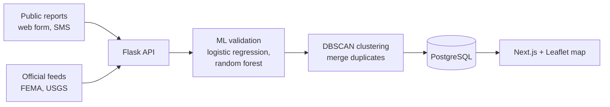
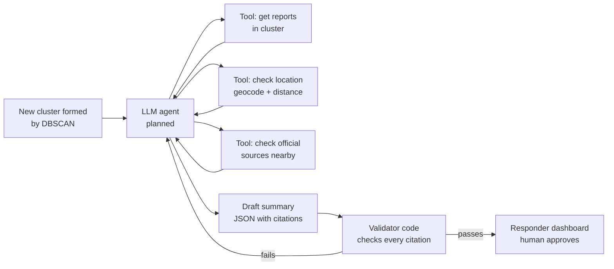

# RescueMap-AI

**An open-source platform for real-time geospatial data validation and disaster response coordination.**

RescueMap-AI enables emergency responders and local teams to collect, validate, and act on location-based reports during active natural disaster operations, without requiring cloud infrastructure, expensive software, or technical expertise.

> Presented at **FOSS4G North America 2025** · Published in **ISJEM (DOI: 10.55041/ISJEM04944)**

---

## The Problem

When a hurricane, flood, or wildfire strikes, emergency responders are flooded with incoming location reports from the public, field teams, and official feeds simultaneously. The challenge is quickly determining **which reports are accurate, which are duplicates, and which areas need immediate prioritization.**

The 2024 Hurricane Helene after-action review documented this directly: responders faced critical challenges with *data handling, information intake, and visualizing operational updates in a timely fashion*, directly impairing situational awareness and decision-making.

RescueMap-AI is designed to address this gap.

---

## What RescueMap-AI Does

RescueMap-AI ingests location-based reports from multiple sources, validates them using lightweight machine learning, clusters nearby reports to remove duplicates, and visualizes the result as a live, color-coded map, so responders can see verified high-priority zones at a glance.

<!-- 
📸 IMAGE PLACEHOLDER 1
Screenshot of the live map interface showing clustered, color-coded report markers.
Verified reports in one color, unverified in another.
Caption: "Live map view: verified vs. unverified incident clusters during a simulated flood event"
-->

---

## Key Features

### Real-Time Geospatial Map
Live map visualization using Leaflet.js. Reports are plotted by location and color-coded by verification status: verified incidents are immediately actionable, unverified ones are flagged for review.

### AI-Powered Validation and Clustering
The validation layer uses logistic regression and random forest classifiers: lightweight, explainable, and runnable on modest hardware with no internet connection. Reports are scored for reliability based on source credibility, geographic clustering, text similarity, and recency.

- **Cluster detection:** Merges near-duplicate reports when multiple sources report the same issue within a small geographic area and timeframe
- **Source credibility scoring:** Official feeds (FEMA, USGS) carry higher confidence weights than unverified public submissions
- **Reliability ranking:** Reports are ranked by `severity × confidence × recency`, a transparent, auditable formula

### Verified vs. Unverified Reporting
Every report is tagged with a verification status. The dashboard displays a live **Verified Rate KPI** so responders know in real time what percentage of their operational picture is based on confirmed information.

<!-- 
📸 IMAGE PLACEHOLDER 2
Screenshot of the dashboard sidebar or KPI panel showing:
- Total Reports count
- Verified Rate percentage
- Duplicates Filtered count
Caption: "Dashboard KPIs: real-time data quality indicators for incident commanders"
-->

### Offline-First Architecture
RescueMap-AI is designed to run in connectivity-scarce environments. The system operates on a single laptop or Raspberry Pi, with no dependency on cloud APIs or external services. It can sync data when connectivity is restored.

The Vercel and Render deployments are a hosted demo. The local setup runs fully offline.

This design directly addresses one of the most documented failure modes in disaster response: cloud-based tools go down exactly when they are most needed.

### Multi-Source Data Ingestion
RescueMap-AI blends crowdsourced inputs with official data streams:

| Source Type | Examples | Default Weight |
|---|---|---|
| Official feeds | FEMA, USGS, local EMAs | High confidence |
| Registered partners | NGOs, trained volunteers | Medium confidence |
| Public submissions | Web forms, SMS, field reports | Provisional: pending validation |

---

## Architecture



System architecture, from report ingestion to map visualization

### Tech Stack

| Layer | Technology |
|---|---|
| Frontend | Next.js + Leaflet.js |
| Backend | Flask + CORS |
| ML / Validation | Scikit-learn, NLTK (logistic regression, random forest, DBSCAN) |
| Database | SQLite → PostgreSQL |
| Mapping | Leaflet.js |
| Hosting | Vercel (frontend) · Render (backend) · Local fallback supported |

---

## Design Decisions

- We chose logistic regression and random forest for validation instead of an LLM because they are explainable and run on modest hardware without an internet connection.
- We chose `severity × confidence × recency` for ranking so responders can audit how reports are prioritized.
- We give official feeds higher confidence weights because source credibility is part of our reliability scoring. Public submissions stay provisional until validation.

---

## Planned: LLM Triage Agent (Design Stage)

This agent is designed but not yet implemented. The current validation pipeline works without it.

### Goal

The agent will turn each cluster of validated reports into a short, evidence-backed summary responders can act on.

### Core principle

The LLM summarizes, code decides. The LLM will never mark anything as verified. Verification status will come only from the existing ML pipeline and rules.

### How it would work

1. **Trigger:** The agent would run once per cluster when DBSCAN creates or updates a cluster, not once per report.
2. **Tools the agent would call:**
   - `get_cluster_reports(cluster_id)` would pull the cluster's reports from PostgreSQL.
   - `check_location(text, lat, lon)` would geocode the place named in the report text and measure its distance from the GPS point. A large mismatch would be a red flag.
   - `get_official_signals(lat, lon)` would return nearby NWS alerts, USGS river gauges, and FEMA flood zones. These would be cached locally for offline use.
3. **Structured output:** The agent would return JSON with summary, location, status (supported, conflicting, or unconfirmed), and an evidence list of report IDs and official source IDs.
4. **Validator:** Plain code would check that every cited ID exists in that cluster and that the status matches the ML pipeline. Failures would be rejected and retried.
5. **Human approval:** Summaries would appear as drafts on the dashboard until a responder approves them.



### Why an OpenAI-compatible API

The same code would call a hosted model when online or a local model, for example through Ollama, when offline. This would keep the offline-first design.

### Testing plan

We will test on about 50 labeled clusters from the CrisisNLP data. We will measure citation errors and how often the agent calls something "supported" that is not. We will rerun these checks on every prompt or model change.

### Status

Design complete, implementation pending. The current ML validation pipeline works without it.

---

## Research

This project is the basis of a peer-reviewed publication:

> **Ahmed, M. B.** (2025). *Disaster Response Systems and Data Integrity: Optimizing Crowdsourced Inputs with Simple Machine Learning.* International Scientific Journal of Engineering and Management.
> DOI: [10.55041/ISJEM04944](https://www.doi.org/10.55041/ISJEM04944)

**Abstract:** A lightweight pipeline employing logistic regression and random forest classifiers, integrated with rule-based validation, to optimize the integrity of crowdsourced disaster inputs with minimal computation. Evaluated on the CrisisNLP tweet corpus and a synthetic sensor dataset. Results demonstrate a **22% increase in precision** and a **0.18 improvement in F1 score** over a heuristic baseline, while maintaining recall above 0.90. Offline-first design enables deployment on modest hardware in connectivity-scarce environments.

---

## Conference Presentation

RescueMap-AI was presented as a workshop at **FOSS4G North America 2025**, the premier open-source geospatial conference in North America. The presentation covered the system architecture, validation methodology, data ethics in humanitarian datasets, and the open-source rationale for disaster response tooling.

<!-- 
📸 IMAGE PLACEHOLDER 4
Photo from the FOSS4G NA 2025 workshop session: presenter at podium or workshop room.
OR: Screenshot of the FOSS4G NA 2025 program listing showing your workshop title and name.
Caption: "Workshop presentation at FOSS4G North America 2025"
-->

---

## Roadmap

RescueMap-AI is an active research and development project. Planned work:

- Build the LLM triage agent described above
- **Expanded ML validation layer**: improved classification for edge cases, multi-language support for diverse disaster-affected communities
- **SMS reporting interface**: enabling citizen submissions via text message with no smartphone or internet required
- **County pilot program**: working with Florida county emergency management offices to validate the system against real operational workflows

---

## Why Open Source

Closed-source tools create single points of failure. When a vendor goes down or pulls access, responders lose their tools at the worst possible moment.

RescueMap-AI is fully open because:
- **Transparency builds trust**: responders and agencies can audit exactly how reliability scores are calculated
- **Adaptability enables local ownership**: local governments and NGOs can fork, modify, and host their own instance
- **Resilience requires no vendor lock-in**: if one deployment fails, the community can stand up another

---

## Getting Started

### Prerequisites
- Python 3.9+
- Node.js 18+

### Project Structure

```
RescueMap-AI/
├── backend/          # Flask API + ML validation layer
├── frontend/         # Original HTML/JS frontend
├── frontend-next/    # Next.js + Leaflet frontend (current)
└── README.md
```

### Run the Backend

```bash
cd backend
python3 -m venv env
source env/bin/activate      
# Windows: env\Scripts\activate
pip install -r requirements.txt
python3 app.py
```

### Run the Frontend

```bash
cd frontend-next
npm install
npm run dev
```

The app will be available at `http://localhost:3000`

---

## Contributing

Contributions are welcome from developers, GIS professionals, emergency management practitioners, and researchers.

If you work in emergency management and are interested in piloting or evaluating RescueMap-AI in your operations, please open an issue or reach out directly.

---

## Citation

If you use RescueMap-AI in your research or reference this work, please cite:

```
Ahmed, M. B. (2025). Disaster Response Systems and Data Integrity: 
Optimizing Crowdsourced Inputs with Simple Machine Learning. 
International Scientific Journal of Engineering and Management. 
DOI: 10.55041/ISJEM04944
```

---

## License

MIT License: free to use, modify, and distribute with attribution.

---

## Contact

**Bilal Ahmed**
Independent Researcher · Software Engineer
[GitHub](https://github.com/m-bilal-ahmed)
